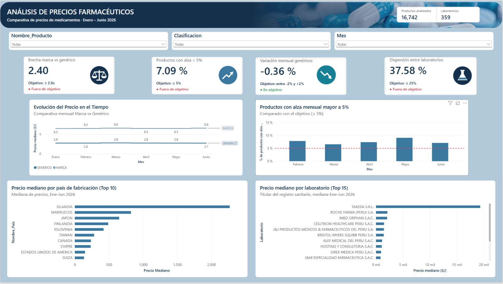

# basav-precios-farmaceuticos-peru

Proyecto final del curso Base de Datos Avanzada y Big Data (UPN). Analizamos los precios de medicamentos en Perú con los datos públicos del Observatorio Peruano de Productos Farmacéuticos (DIGEMID), de enero a junio de 2026. Son 92 816 registros.

Usamos los mismos datos de dos maneras:

- **BI:** los datos están en un esquema en estrella en SQL Server (base `DW_PreciosDigemid`) y se muestran en un dashboard de Power BI con 4 KPI, cada uno con su objetivo.
- **Big Data:** los datos se procesan en Databricks Free Edition (serverless) con Apache Spark 4.2.0 y PySpark. Hay capas Bronze, Silver y Gold, análisis exploratorio, limpieza y datos sintéticos de 100 000, 500 000 y 1 000 000 de filas.

Cada integrante hizo un experimento de BI y uno de Big Data. El análisis y los resultados completos están en el informe final. Aquí está lo necesario para repetirlos: código, datos, scripts, notebooks y evidencias.

Si nunca has usado estas herramientas, empieza por la [guía paso a paso](docs/GUIA_PASO_A_PASO.md). Explica todo desde la instalación.


## Tabla de contenidos

- [KPI del proyecto](#kpi-del-proyecto)
- [Estructura del repositorio](#estructura-del-repositorio)
- [Dependencias](#dependencias)
- [Cómo replicar la parte BI](#cómo-replicar-la-parte-bi-sql-server-y-power-bi-paso-a-paso)
- [Cómo replicar la parte Big Data](#cómo-replicar-la-parte-big-data-databricks-paso-a-paso)
- [Datos sintéticos](#datos-sintéticos)
- [Experimentos](#experimentos)
- [Preguntas frecuentes y solución de problemas](#preguntas-frecuentes-y-solución-de-problemas)
- [Equipo](#equipo)
- [Fuente de datos](#fuente-de-datos)

## KPI del proyecto

Los 4 indicadores están en el dashboard junto a su objetivo. Son del mes de junio de 2026 y se calculan con medianas:

| KPI | Indicador | Objetivo | Valor | Estado |
|---|---|---|---|---|
| 1 | Brecha de precio marca / genérico | ≤ 2,0x | 2,40 | Fuera de objetivo |
| 2 | % de productos con alza mensual > 5 % | ≤ 5 % | 7,09 % | Fuera de objetivo |
| 3 | Variación mensual del precio mediano de genéricos | entre −2 % y +2 % | −0,36 % | En objetivo |
| 4 | Dispersión de precio entre laboratorios (CV) | ≤ 25 % | ≈ 37,6 % | Fuera de objetivo |

Calculamos los mismos KPI en Spark (tabla `gold_kpis`) y en Power BI. Solo el KPI 4 cambia un poco: 37,5 % en Spark y 37,58 % en Power BI, porque cada herramienta lo calcula con un método distinto.



## Estructura del repositorio

```
basav-precios-farmaceuticos-peru/
│
├── datos/
│   ├── EXCEL-BASE DE DATOS.zip           Los 6 archivos Excel originales de DIGEMID (ene–jun 2026)
│   └── datos_listos.csv                  Datos limpios (92 816 registros), generados por 01_preparar_datos.py
│
├── scripts/                              Python y SQL (ETL, base de datos, datos sintéticos, experimentos BI)
│   └── README.md                         Qué hace cada script y en qué orden se usa
│
├── bigdata/                              Notebooks de Databricks (PySpark)
│   ├── 00_configuracion.ipynb            Crea el esquema y el volume
│   ├── 01_carga_eda.ipynb                Carga, EDA, limpieza, Medallion y KPI en Gold
│   ├── experimentos/                     Un notebook por experimento Big Data
│   └── README.md
│
├── Dashboard/
│   ├── proyecto.pbix                     Dashboard final de Power BI
│   ├── experimentos/                     Copias del dashboard usadas en experimentos de rendimiento
│   └── README.md
│
├── evidencias/                           Capturas y archivos de evidencia, por integrante y experimento
│   └── README.md
│
├── docs/
│   └── GUIA_PASO_A_PASO.md               Guía detallada para principiantes: instalación y todos los experimentos
│
│
└── README.md                             Este archivo
```

Los datos sintéticos **no están en el repositorio** (los de 500 000 y 1 000 000 de filas superan los 100 MB que permite GitHub); se regeneran con un script (ver [Datos sintéticos](#datos-sintéticos)).

## Dependencias

Para replicar el proyecto en Windows:

| Programa | Para qué sirve | Dónde descargarlo |
|---|---|---|
| **Python 3.x** (probado con 3.14) | Limpiar los datos y generar los datos sintéticos | [python.org/downloads](https://www.python.org/downloads/) |
| **SQL Server Express** (2022 o 2025) | Base de datos del modelo en estrella y experimentos BI | [Microsoft SQL Server Downloads](https://www.microsoft.com/es-pe/sql-server/sql-server-downloads) |
| **SQL Server Management Studio (SSMS)** | Ejecutar los scripts de SQL | [Descarga de SSMS](https://learn.microsoft.com/es-es/sql/ssms/download-sql-server-management-studio-ssms) |
| **Power BI Desktop** | Abrir el dashboard | [Microsoft Store o powerbi.microsoft.com](https://www.microsoft.com/es-pe/power-platform/products/power-bi/downloads) |
| **Cuenta de Databricks Free Edition** | Notebooks de Big Data (cómputo serverless, Spark 4.2.0) | [databricks.com/learn/free-edition](https://www.databricks.com/learn/free-edition) |

Cada integrante ejecutó los experimentos de BI en su propio equipo; la versión exacta de SQL Server y los recursos (CPU) de cada uno están indicados en el informe y en las capturas de entorno de la carpeta `evidencias/`.


## Cómo replicar la parte BI (SQL Server y Power BI), paso a paso

Haz los pasos en orden y sin saltarte ninguno.

### Paso 1: Descargar el repositorio completo

1. En la página de este repositorio en GitHub, haz clic en el botón verde **"Code"**.
2. Haz clic en **"Download ZIP"**.
3. Ve a tu carpeta de Descargas, haz clic derecho sobre el archivo ZIP descargado y elige **"Extraer todo..."**.
4. Elige una carpeta fácil de encontrar (por ejemplo, el Escritorio) y extrae ahí.

### Paso 2: Descomprimir los archivos Excel originales

1. Entra a la carpeta que acabas de extraer, y luego a la subcarpeta `datos`.
2. Ahí vas a ver un archivo llamado `EXCEL-BASE DE DATOS.zip`.
3. Haz clic derecho sobre él → **"Extraer todo..."** → Extraer en esa misma carpeta.
4. Debería aparecer una carpeta llamada **`EXCEL-BASE DE DATOS`**, con 6 archivos Excel adentro (`MTC 202601.xlsx` hasta `MTC 202606.xlsx`).

### Paso 3: Preparar los datos con el script de Python

1. Ve a la carpeta `scripts` y copia el archivo `01_preparar_datos.py`.
2. Pégalo **dentro** de la carpeta `EXCEL-BASE DE DATOS` (debe quedar en el mismo lugar que los 6 Excel, no afuera).
3. Haz doble clic sobre `01_preparar_datos.py`. (Si prefieres la terminal: `py 01_preparar_datos.py`; si `python` no se reconoce, usa `py`.)
4. Se va a abrir una ventana negra (la consola de Windows). **No la cierres.** Vas a ver mensajes parecidos a estos:
   ```
   Carpeta de Excel: ...
   Se encontraron 6 archivos:
     Leyendo 2026-01  ->  MTC 202601.xlsx ...
        filas de datos: 15266
   ...
   Listo. Se genero el archivo: datos_listos.csv
   Total de registros: 92816
   ```
5. Al final, la ventana te pide presionar **Enter** para cerrarse. Puedes hacerlo una vez que confirmes que no hubo errores.
6. Dentro de la carpeta `EXCEL-BASE DE DATOS` debería haber aparecido un nuevo archivo: **`datos_listos.csv`**.

**Si te sale un mensaje de ERROR en la consola:** significa que algo no se pudo procesar (por ejemplo, falta algún Excel, o el CSV ya estaba abierto en Excel). Lee el mensaje de error, que explica qué pasó, ciérralo si está abierto en otro programa, y vuelve a intentar.

### Paso 4: Copiar la ruta de los datos preparados

1. Dentro de la carpeta `EXCEL-BASE DE DATOS`, haz clic una vez sobre la barra de direcciones de arriba (donde se ve la ruta de la carpeta).
2. Se va a seleccionar todo el texto de la ruta. Cópialo (Ctrl+C). Guárdalo en algún lugar (por ejemplo, pégalo en el Bloc de notas) para usarlo en el siguiente paso.

### Paso 5: Abrir SQL Server Management Studio y conectarte

1. Abre **SQL Server Management Studio (SSMS)**.
2. Te va a aparecer una ventana llamada "Conectar al servidor". Tienes 2 formas de conectarte, según cómo esté configurado tu SQL Server:
   - **Autenticación de Windows** (la más común en instalaciones personales): deja la opción tal como está y haz clic en **"Conectar"**.
   - **Autenticación de SQL Server**: si tu instalación te pide usuario y contraseña, selecciona esa opción e ingresa tus credenciales.
3. Una vez conectado, ve a **Archivo → Abrir → Archivo...**, y busca `scripts/02_crear_y_cargar_base_datos.sql` dentro de la carpeta que descargaste.

### Paso 6: Configurar la ruta del archivo CSV dentro del script

1. Con el script ya abierto en SSMS, usa **Ctrl+F** (Buscar) y escribe: `CAMBIAR_RUTA`
2. Vas a encontrar esta línea:
   ```sql
   FROM 'CAMBIAR_RUTA\datos_listos.csv'
   ```
3. Reemplaza únicamente la palabra `CAMBIAR_RUTA` por la ruta que copiaste en el Paso 4, dejando `\datos_listos.csv` al final. Por ejemplo, si tu ruta era `C:\Users\Juan\Desktop\basav-precios-farmaceuticos-peru\datos\EXCEL-BASE DE DATOS`, la línea debería quedar así:
   ```sql
   FROM 'C:\Users\Juan\Desktop\basav-precios-farmaceuticos-peru\datos\EXCEL-BASE DE DATOS\datos_listos.csv'
   ```

### Paso 7: Ejecutar el script y crear la base de datos

1. Con el cursor en cualquier parte del script, presiona la tecla **F5** (o el botón "Ejecutar" en la barra de herramientas de SSMS).
2. El script va a tardar unos segundos. Observa el panel de **"Mensajes"**, abajo. Deberías ver, en orden:
   ```
   Base de datos y tablas creadas.
   Datos cargados a STG_PRECIOS.
   Dimensiones pobladas.
   Tabla de hechos poblada.
   ```
3. Después de eso, van a aparecer 2 tablas de resultados en el panel de **"Resultados"**: una con el conteo de filas de cada tabla (deberías ver `HECHO_PRECIO` con 92,816 filas), y otra con 20 registros de ejemplo, ya combinados.

**Si algo sale mal:** por ejemplo, si la ruta del CSV está mal escrita y no se carga ningún dato, el script se detiene y muestra un error en rojo. No sigue con datos incompletos.

**Si necesitas repetir este paso** (por ejemplo, te equivocaste en algo), no pasa nada. El script borra la base anterior y la crea de nuevo, así que puedes ejecutarlo las veces que quieras sin duplicar datos.

### Paso 8: Conectar Power BI a la base de datos

1. Abre **Power BI Desktop**.
2. Ve a **Inicio → Obtener datos → SQL Server**.
3. En la ventana que aparece:
   - **Servidor:** escribe el mismo nombre de servidor que usaste para conectarte en SSMS (Paso 5). Si no lo recuerdas, ábrelo de nuevo en SSMS y fíjate en el campo "Nombre del servidor" de la ventana de conexión.
   - **Base de datos:** escribe `DW_PreciosDigemid`
4. Haz clic en **"Aceptar"**.
5. Si te pide el método de autenticación, elige el mismo que usaste en el Paso 5 (Windows o SQL Server) y confirma.
6. Se va a abrir el **"Navegador"**, con la lista de tablas disponibles. Marca las casillas de estas 6 tablas:
   - `HECHO_PRECIO`
   - `DIM_TIEMPO`
   - `DIM_PRODUCTO`
   - `DIM_LABORATORIO`
   - `DIM_CLASIFICACION`
   - `DIM_PAIS_ORIGEN`
7. Elige el modo de conexión **"Importar"** y haz clic en **"Cargar"**.

### Paso 9: Verificar que todo quedó bien

1. En el panel derecho de Power BI (**"Datos"**), deberías ver las 6 tablas que acabas de cargar, cada una con sus columnas.
2. Si las ves todas, ¡el proceso está completo! Ya puedes construir o abrir el dashboard.

---

## Cómo replicar la parte Big Data (Databricks), paso a paso

> Los datos sintéticos (siguiente sección) se generan antes del paso 6. Si es tu primera vez, mira también la [guía detallada](docs/GUIA_PASO_A_PASO.md), que explica cada clic.

1. **Crear la cuenta.** Entra a [databricks.com/learn/free-edition](https://www.databricks.com/learn/free-edition), pulsa *Sign up for Free Edition*, regístrate con tu correo y confírmalo. No pide tarjeta.
2. **Importar los notebooks.** En el menú izquierdo pulsa **Workspace**, luego **⋮ → Import**, y arrastra los archivos `.ipynb` de la carpeta `bigdata/` y de `bigdata/experimentos/`.
3. **Conectar el cómputo.** Abre `00_configuracion.ipynb`. Arriba a la derecha pulsa **Connect** y elige **Serverless**. Pulsa **Run all**. Esto crea el esquema `workspace.ef_precios_medicamentos` y el volume `datos` (la carpeta donde se suben los archivos).
4. **Subir los datos.** Menú **Catalog → workspace → ef_precios_medicamentos → datos → Upload to this volume**, y sube `datos/datos_listos.csv`. La ruta queda `/Volumes/workspace/ef_precios_medicamentos/datos/`.
5. **Cargar y explorar.** Abre `01_carga_eda.ipynb`, conéctalo a **Serverless** y pulsa **Run all**. Carga el CSV, hace el análisis exploratorio y la limpieza, crea las tablas Bronze y Silver, calcula los KPI en Gold y grafica.
6. **Subir los datos sintéticos.** Repite el paso 4 con `sinteticos_100k.csv`, `sinteticos_500k.csv` y `sinteticos_1m.csv` (el de 1M pesa ≈229,2 MB y tarda más en subir).
7. **Ejecutar un experimento.** Abre un notebook de `bigdata/experimentos/`, conéctalo a **Serverless** y ejecuta **celda por celda** (`Shift + Enter`), esperando a que cada una termine (marca verde) antes de pasar a la siguiente. Cada notebook hace **1 calentamiento descartado + 3 repeticiones** y reporta la **mediana**.
8. **Guardar la evidencia.** Toma captura de la tabla de resultados y, si quieres, del *Query Profile* (debajo de la celda: **See performance → View query profile**).

Cada cuenta de Databricks es independiente y las tablas no se comparten. Por eso cada integrante subió sus propios datos y corrió sus notebooks en su cuenta.

Todos los experimentos (BI y Big Data), con el resultado que debería salir, están explicados en [`docs/GUIA_PASO_A_PASO.md`](docs/GUIA_PASO_A_PASO.md).


## Datos sintéticos

Para los experimentos de volumen se generan datasets de **100 000, 500 000 y 1 000 000 de filas** a partir de los 92 816 registros reales. El script `scripts/generar_sinteticos.py` crea productos nuevos tomando productos reales y conserva laboratorio, país, clasificación (marca/genérico), forma farmacéutica, concentración, los 6 meses y la forma en que cambia el precio mes a mes. Cambia el código del producto, el nivel de precio (factor aleatorio, **semilla 42**, distribución lognormal σ = 0,20) y, levemente, el número de establecimientos. Al terminar imprime una validación (proporción de marca, precio mediano, % de alzas, laboratorios y países) comparando lo real con lo sintético.

Desde la carpeta del repositorio (necesita solo Python):

```
py scripts/generar_sinteticos.py datos/datos_listos.csv 100000  sinteticos_100k.csv
py scripts/generar_sinteticos.py datos/datos_listos.csv 500000  sinteticos_500k.csv
py scripts/generar_sinteticos.py datos/datos_listos.csv 1000000 sinteticos_1m.csv
```

Los archivos se guardan en la carpeta donde ejecutas el comando. Para Databricks, súbelos al volume `datos`. Para los experimentos de SQL Server, copia `sinteticos_1m.csv` a `C:\datos\` (el servicio de SQL Server debe poder leerlo).

## Experimentos

> El procedimiento detallado de cada experimento (qué script abrir, qué bloque ejecutar y qué resultado esperar) está en [`docs/GUIA_PASO_A_PASO.md`](docs/GUIA_PASO_A_PASO.md).

Cada integrante hizo un experimento de BI y uno de Big Data. En todos se descarta 1 calentamiento, se repite 3 veces cada configuración y se reporta la mediana. Los resultados completos están en el informe final.

| ID | Tipo | Responsable | Qué compara | Código | Evidencias |
|---|---|---|---|---|---|
| E-BI-1 | BI | Ingrid | Consulta con y sin **índice** no agrupado (1M de filas) | `scripts/EXP_BI_ingrid_indice.sql` | `evidencias/ingrid/BI_Exp1_Indice/` |
| E-BI-2 | BI | Ingrid | **Carga masiva** con `BULK INSERT`: TABLOCK (con/sin) × BATCHSIZE (10 000 / 100 000) | `scripts/EXP_BI_ingrid_carga.sql` | `evidencias/ingrid/BI_Exp2_Carga_masiva/` |
| E-BI-3 | BI | Samuel | **Paralelismo** (`MAXDOP 1` frente al valor por defecto), en SQL Server Express y Developer | `scripts/Samuel_EXP_BI.sql`, `scripts/Samuel_EXP_BI_dev.sql` | `evidencias/samuel/` (`Samuel_BI_*`) |
| E-BI-4 | BI | Gonzalo | **Volumen de registros** (100k, 500k y 1M) en SQL Server | `scripts/EXP_BI_gonzalo_volumen.sql` | `evidencias/gonzalo/` (`Gonzalo_BI_*`) |
| E-BI-5 | BI | Steve | Dashboard en modo **Importar frente a DirectQuery** (Analizador de rendimiento) | `Dashboard/experimentos/dashboard_DirectQuery.pbix` | `evidencias/steve/` (`Steve_BI_*`) |
| E-BD-1 | Big Data | Ingrid | **Volumen de datos** (100k, 500k y 1M): lectura, filtro y agrupaciones | `bigdata/experimentos/EF_exp_ingrid.ipynb` | `evidencias/ingrid/BigData_Exp1_Volumen_de_datos/` |
| E-BD-2 | Big Data | Ingrid | **Tipo de operación** en Spark (lectura CSV, narrow, wide, resumen, escritura Delta) | `bigdata/experimentos/EF_exp_ingrid_operaciones.ipynb` | `evidencias/ingrid/BigData_Exp2_Tipo_de_operacion/` |
| E-BD-3 | Big Data | Samuel | **Número de particiones** (1, 2, 4, 8, 16 y 32) con 1M de filas | `bigdata/experimentos/EF_exp_samuel.ipynb` | `evidencias/samuel/` (`Samuel_EXP_*`) |
| E-BD-4 | Big Data | Gonzalo | **Formato de archivo**: CSV frente a Parquet (100k, 500k y 1M) | `bigdata/experimentos/EF_exp_gonzalo.ipynb` | `evidencias/gonzalo/` (`Gonzalo_EXP_*`) |
| E-BD-5 | Big Data | Steve | Lectura con **inferSchema frente a esquema explícito** (100k, 500k y 1M) | `bigdata/experimentos/EF_exp_Steve.ipynb` | `evidencias/steve/` (`Steve_EXP_*`) |

Resultados destacados de los experimentos de Ingrid (medianas, entorno descrito en el informe):

- **E-BI-1:** con índice, la consulta de filtro pasa de 37 ms a menos de 1 ms y las lecturas lógicas de 9 175 a 3; la consulta agrupada mejora 2,0× (133,8 → 65,7 ms).
- **E-BI-2:** `TABLOCK` con lote de 100 000 carga 1M de filas 1,32× más rápido que sin TABLOCK con lote de 10 000, y usa ≈7 MB de log frente a ≈300 MB.
- **E-BD-1:** al multiplicar los datos por 10, el tiempo solo crece entre 1,6× y 2,0× (crece menos que el volumen); no hubo spilling.
- **E-BD-2:** la escritura Delta (2,84 s) y la lectura del CSV (2,07 s) son las operaciones más costosas; las transformaciones wide no resultaron más lentas que las narrow con 1M de filas.

## Preguntas frecuentes y solución de problemas

**"Al correr el Python me sale 'No encontre los Excel'."**
Verifica que el script `01_preparar_datos.py` esté **dentro** de la carpeta `EXCEL-BASE DE DATOS`, al mismo nivel que los 6 archivos `.xlsx`, no en la carpeta de afuera.

**"Al correr el SQL me sale 'el BULK INSERT no cargo filas'."**
Revisa que la ruta que pusiste en el Paso 6 sea exactamente correcta, con `\datos_listos.csv` al final, y que el archivo realmente exista ahí.

**"No sé cuál es el nombre de mi servidor de SQL Server."**
Ábrelo desde SSMS: al abrir el programa, la ventana de conexión ya trae escrito el nombre correcto en el campo "Nombre del servidor" (frecuentemente es `localhost` o `NOMBRE-DE-TU-PC\SQLEXPRESS`).

**"¿Por qué el script de Python no usa pandas?"**
Para que corra en cualquier computadora que tenga Python, sin instalar librerías. Así hay menos cosas que puedan fallar en una demostración en vivo.


## Equipo

| Integrante | Experimentos |
|---|---|
| Ingrid Aybar | BI: índice (E-BI-1) y carga masiva (E-BI-2). Big Data: volumen (E-BD-1) y tipo de operación (E-BD-2). Dashboard, repositorio y documentación |
| Samuel Gutiérrez | BI: paralelismo (E-BI-3). Big Data: particiones (E-BD-3) |
| Alvaro Gonzalo Espinoza | BI: volumen de registros (E-BI-4). Big Data: CSV frente a Parquet (E-BD-4) |
| Steve Tirado | BI: Importar frente a DirectQuery (E-BI-5). Big Data: inferSchema frente a esquema explícito (E-BD-5) |
| Cristofer Buleje | Diseño inicial de los experimentos de tipo de operación (Big Data) y carga masiva (BI); la ejecución y la evidencia final (E-BD-2 y E-BI-2) las realizó Ingrid |

## Fuente de datos

Dirección General de Medicamentos, Insumos y Drogas (DIGEMID). *Indicador de precios de productos farmacéuticos*. Ministerio de Salud del Perú.

